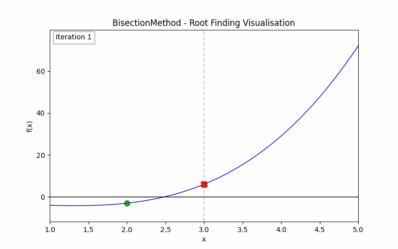

# Bisection Method - Root Finding

## My Role

Implementation of the bisection root finding method.

### Key Contributions:

- **Root Finding Framework**  
  - Designed an extensible `RootFinder` base class with reusable methods (`findRoot`, `visualise`, `output`).
  - Implemented the `BisectionMethod` subclass, defining:
  - The Intermediate Value Theorem (IVT) decision rule.
  - Error evaluation via the interval length.
  - The midpoint update step for each iteration.
  
- **Error Handling**  
  - Created a custom `RootFindingError` exception for clearer debugging and control flow.
  
- **Visualisation**  
  - Implemented an animated visualisation of the IVT process:
  - Colour-coded interval updates per iteration.
  - Midpoint markers for each bisection step.
  - Fixed axes for consistent view.
  - Export to GIF format for inclusion in reports or presentations.
  - Fully reusable across subclasses (e.g., future Newton–Raphson or Secant methods).
  

  

